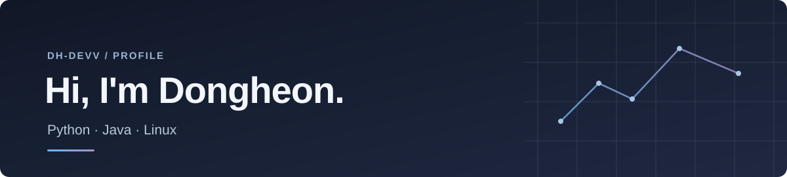

**Computer Science Student** · South Korea

---

### About

I'm a computer science student studying programming and systems, with an interest in Java backend development.

### Currently learning

**On my learning roadmap:** Spring Boot · JPA · MySQL · Docker · AWS

### Project

**[LAST SPARK — Project Escape](https://github.com/dh-devv/project-escape)** · AI-assisted team project

A 2D action game where losing HP changes the player's abilities. The team project includes boss fights and score rankings.

**My contributions:** backend, database, Unity–API integration, and Docker/AWS deployment setup. 
**Project tech:** Unity · Spring Boot · MySQL · Docker · AWS

### Study notes

- [**Java Practice**](https://github.com/dh-devv/java-practice) — fundamentals and object-oriented programming
- [**Python Practice**](https://github.com/dh-devv/python-practice) — basics, algorithms, and web crawling
- [**C Practice**](https://github.com/dh-devv/c-practice) — C programming fundamentals
- [**Linux Practice**](https://github.com/dh-devv/linux-practice) — Ubuntu commands and shell scripting

---

Consistency beats intensity.

